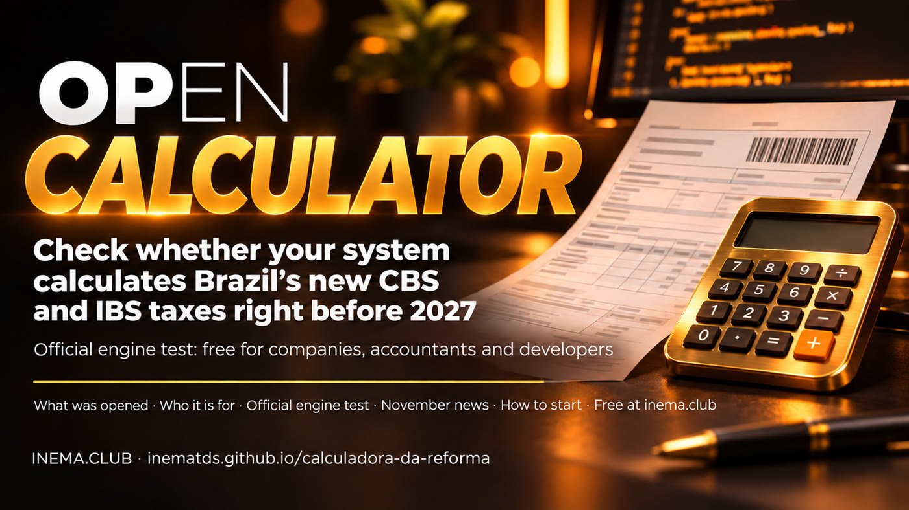

# Open calculator: check whether your system calculates CBS and IBS correctly

**🇧🇷 [Português](README.md) · 🇺🇸 [English](README.en.md) · 🇪🇸 [Español](README.es.md)**

[](https://inematds.github.io/calculadora-da-reforma/guia/en/)

## What it is

This kit explains and helps you run the three programs the Federal Revenue Service published on GitHub in November 2026: the CBS, IBS, and Selective Tax calculator (for companies under the regular tax regime), the Simples Nacional calculator, and the service invoice PDF generator (DANFSe). It is for companies, accountants, developers, and anyone curious. The kit includes the **official engine test**: the same transaction calculated in your system and in the Federal Revenue Service program, side by side, with any difference identified. Ask your AI to read the kit and show you the results. If you prefer to do it yourself, you need a computer with Java 25. **This is not a Federal Revenue Service product**: it is an INEMA kit built on its open source code.

## 📖 User guide

Complete guide (what it is, who it’s for, November updates, how to get started): **https://inematds.github.io/calculadora-da-reforma/guia/en/**

<!-- VIDEO: entra o explicavideo do projeto quando publicado -->

## Ask your AI

Open Claude Code or Codex in a folder on your computer and paste:

```text
Read the "calculadora-da-reforma" kit at https://github.com/inematds/calculadora-da-reforma (the README explains everything, including the technical installation).
Then, on this computer:
1. Check whether the Federal Revenue Service code is the original (the conferir-origem script) and tell me the result.
2. Check whether I have what’s needed (Java 25; Go only for the invoice PDF). If anything is missing, explain what’s missing and wait for me to say yes before downloading anything.
3. Start the calculator and run the official example. Show me the tax for each item and the reason, in plain English.
4. Tell me how I would run the same test with my company’s sales.
Don’t change anything in my system or files. Show me the plan and wait for me to say yes.
```

## What’s included

| File | Purpose |
|---|---|
| [kit/PARA-QUEM.md](kit/PARA-QUEM.md) | The 3 programs explained, and what each offers to individuals, companies, developers, and accountants |
| [kit/NOVIDADES.md](kit/NOVIDADES.md) | What changed in November 2026 (the 11.3% rate indicated by the TCU, new versions, technical notes), with sources |
| [kit/MEDICOES.md](kit/MEDICOES.md) | What we actually ran: numbers, times, versions, and pitfalls |
| `kit/scripts/conferir-origem.sh` | Checks whether the code on GitHub matches the code in the Ordinance (initial release commit) |
| `kit/scripts/subir-calculadoras.sh` | Downloads, compiles, and starts the 3 programs only on your computer |
| `kit/scripts/teste_do_motor.py` | The official engine test: your system × the Federal Revenue Service engine, and rate scenarios |
| `kit/exemplos/` | Official transaction, scenario with 11.3% CBS, Simples transaction, values from a faulty “system,” fictional NFS-e, and generated PDF |

> **Attention.** The Federal Revenue Service code has no force of law and no public support (Portaria Cotec nº 342/2026, art. 6º). Responsibility for the tax remains with whoever issues the invoice. The MIT license allows use of the code, but not the Federal Revenue Service name or symbols to suggest that a product is official. This kit is not official.

---

## Technical installation

### Prerequisites

- `git`, `curl`, Python 3 (standard library only).
- **Java 25 or newer** for the two calculators (JDK 8, 17, or 21 won’t work). No system-wide installation needed: download JDK 25 from [Adoptium](https://adoptium.net), extract it, and use `JAVA_HOME=/caminho/jdk-25`.
- **Go 1.22+** only for the DANFSe generator (optional).
- Internet access the first time (the Maven Wrapper downloads the dependencies). After that, it runs offline (the `offline` profile).
- Tested on Linux arm64 (23/11/2026). The official repositories also provide commands for Windows.

### Step by step

```bash
git clone https://github.com/inematds/calculadora-da-reforma && cd calculadora-da-reforma

# 1. Check the source (compares the initial tags with the Ordinance commits)
bash kit/scripts/conferir-origem.sh

# 2. Download, compile, and start the 3 programs in ./motores (only on 127.0.0.1)
JAVA_HOME=/caminho/jdk-25 bash kit/scripts/subir-calculadoras.sh
#    default ports 8080 (regular), 8082 (Simples), 8090 (DANFSe); to change them:
#    PORTA_REGULAR=18080 PORTA_SIMPLES=18082 PORTA_DANFSE=18090 bash kit/scripts/subir-calculadoras.sh

# 3. Calculate the official example (rice, beer with IS, school, item with an error)
python3 kit/scripts/teste_do_motor.py kit/exemplos/operacao-oficial.json

# 4. Official engine test: compare against what YOUR system calculated
python3 kit/scripts/teste_do_motor.py kit/exemplos/operacao-oficial.json --meu kit/exemplos/meu-sistema-exemplo.json

python3 kit/scripts/teste_do_motor.py kit/exemplos/minhas-vendas.csv --data 2027-03-10   # your spreadsheet (Excel → CSV, ; separator)

# 5. CBS rate scenarios (8.8% from the official example × 11.3% from the TCU)
python3 kit/scripts/teste_do_motor.py kit/exemplos/operacao-oficial.json --cbs 8.8 11.3

# 6. Simples Nacional
curl -s -X POST http://127.0.0.1:8082/api/calculadora/observabilidade/simples-nacional \
  -H 'Content-Type: application/json' -d @kit/exemplos/operacao-simples.json

# 7. NFS-e PDF (DANFSe) from XML
curl -s -X POST "http://127.0.0.1:8090/api/danfse" -H 'Content-Type: application/xml' \
  --data-binary @kit/exemplos/nfse-exemplo.xml -o danfse.pdf

# Shut down
kill $(cat motores/logs/*.pid)
```

To use your own transactions: create JSON in the format of `kit/exemplos/operacao-oficial.json` (the Swagger UI at `http://127.0.0.1:8080/api/swagger-ui.html` shows all fields) and `meu.json` with the `vCBS`/`vIBS` your system calculated for each item number. `teste_do_motor.py` exits with code 1 if any item differs by more than `--tolerancia` (default R$ 0,01) or has an input error, so it can be used for automated testing (CI).

### Pitfalls we found (and the script already works around)

1. The database step fails with `SQLITE_CANTOPEN` if the `calculadora/db` folder doesn’t exist: the official README doesn’t say to create it.
2. Simples Nacional doesn’t have a `flyway/` folder (issue #5 open): it uses the same database as the regular tax regime.
3. The response with observability is HTTP 200 even when an item is wrong: check each item’s `estadoItem`.
4. In 2027, `aliquotasNominais` is required, and the result is `CALCULO_SIMULADO` until the official rates are registered.
5. In Simples, without `pIBSSN`/`pCBSSN`, the item returns VSN-004/VSN-006: the effective rate comes from PGDAS-D.
6. The SHA-512 of the Ordinance ZIP files doesn’t match the ZIP generated by GitHub; check by commit.

Details and numbers: [kit/MEDICOES.md](kit/MEDICOES.md).

## The process, from start to finish

| # | Step | Command | Who |
|---|---|---|---|
| 1 | Check that the code is the one published in the Ordinance | `bash kit/scripts/conferir-origem.sh` | ⚙️ script |
| 2 | Download, compile, and start the 3 engines | `bash kit/scripts/subir-calculadoras.sh` | ⚙️ script |
| 3 | Calculate the official example and read the calculation details | `python3 kit/scripts/teste_do_motor.py kit/exemplos/operacao-oficial.json` | ⚙️ script |
| 4 | Put together the company’s most common transactions and what your system calculated | `kit/exemplos/*.json` as a template | 🧠 you (or AI, with your approval) |
| 5 | Official engine test | `teste_do_motor.py OPERACAO.json --meu MEU.json` | ⚙️ script |
| 6 | Rate scenarios until the Senate sets the CBS rate | `teste_do_motor.py OPERACAO.json --cbs 8.8 11.3` | ⚙️ script |
| 7 | Take differences to your vendor/accountant; repeat with each new Federal Revenue Service version | `git -C motores/<repo> pull` + steps 2–5 | 🧠 you |

## Sources

- [Portaria Cotec nº 342/2026 (DOU de 13/11/2026)](https://www.in.gov.br/web/dou/-/portaria-cotec-n-342-de-12-de-novembro-de-2026-744398356)
- [Federal Revenue Service: announcement of publication on GitHub](https://www.gov.br/receitafederal/pt-br/assuntos/noticias/2026/novembro/receita-federal-publica-primeiro-codigo-fonte-aberto-no-github-e-amplia-transparencia-da-reforma-tributaria)
- Repositories: [regular regime](https://github.com/ReceitaFederal/calculadora-rtc-regime-regular) · [Simples Nacional](https://github.com/ReceitaFederal/calculadora-rtc-simples-nacional) · [DANFSe generator](https://github.com/ReceitaFederal/calculadora-rtc-gerador-danfse)
- November updates with sources: [kit/NOVIDADES.md](kit/NOVIDADES.md)

## License

Kit (texts, scripts, examples): MIT. The Federal Revenue Service code follows the MIT license in its repositories and is not copied here (the script downloads it directly from the source).

---

Free at [inema.club](https://inema.club), directly on the internet.
