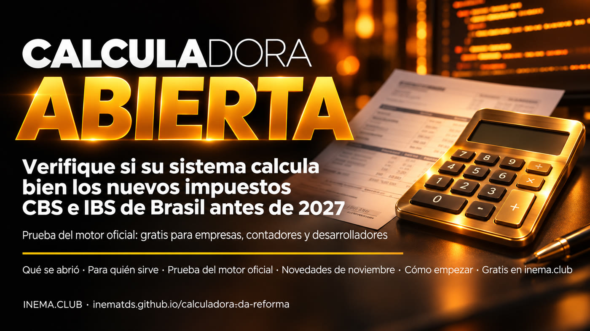

# Calculadora abierta: comprueba si tu sistema calcula correctamente la CBS y el IBS

**🇧🇷 [Português](README.md) · 🇺🇸 [English](README.en.md) · 🇪🇸 [Español](README.es.md)**

[](https://inematds.github.io/calculadora-da-reforma/guia/es/)

## Qué es

Este kit explica y pone en marcha los tres programas que la Receita Federal publicó en GitHub en noviembre de 2026: la calculadora de la CBS, el IBS y el Impuesto Selectivo (empresas del régimen regular), la calculadora del Simples Nacional y el generador del PDF de la factura de servicios (DANFSe). Está dirigido a empresas, contadores, desarrolladores y personas curiosas. El kit incluye la **prueba del motor oficial**: la misma operación calculada en tu sistema y en el programa de la Receita, una al lado de la otra, con la diferencia señalada. Pídele a tu IA que lea el kit y te muestre el resultado. Si prefieres hacerlo manualmente, necesitas una computadora con Java 25. **No es un producto de la Receita**: es un kit de INEMA basado en su código abierto.

## 📖 Guía de uso

Guía completa (qué es, para quién, novedades de noviembre, cómo empezar): **https://inematds.github.io/calculadora-da-reforma/guia/es/**

<!-- VIDEO: entra o explicavideo do projeto quando publicado -->

## Pídeselo a tu IA

Abre Claude Code o Codex en una carpeta de tu computadora y pega esto:

```text
Lee el kit "calculadora-da-reforma" en https://github.com/inematds/calculadora-da-reforma (el README explica todo, incluida la instalación técnica).
Luego, en esta computadora:
1. Comprueba si el código de la Receita Federal es el original (script conferir-origem) y dime el resultado.
2. Revisa si tengo lo necesario (Java 25; Go solo para el PDF de la factura). Si falta algo, explícame qué falta y espera a que te diga que sí antes de descargar cualquier cosa.
3. Inicia la calculadora y ejecuta el ejemplo oficial. Muéstrame en español sencillo el impuesto de cada artículo y el motivo.
4. Dime cómo haría la misma prueba con las ventas de mi empresa.
No cambies nada en mi sistema ni en mis archivos. Muéstrame el plan y espera a que te diga que sí.
```

## Qué hay aquí

| Archivo | Para qué sirve |
|---|---|
| [kit/PARA-QUEM.md](kit/PARA-QUEM.md) | Los 3 programas explicados y qué obtiene la persona, la empresa, el desarrollador y el contador |
| [kit/NOVIDADES.md](kit/NOVIDADES.md) | Qué cambió en noviembre de 2026 (tasa del 11,3% indicada por el TCU, versiones nuevas, notas técnicas), con fuentes |
| [kit/MEDICOES.md](kit/MEDICOES.md) | Lo que ejecutamos de verdad: cifras, tiempos, versiones y trampas |
| `kit/scripts/conferir-origem.sh` | Comprueba si el código en GitHub es el de la Portaria (commit de las versiones iniciales) |
| `kit/scripts/subir-calculadoras.sh` | Descarga, compila e inicia los 3 programas solo en tu computadora |
| `kit/scripts/teste_do_motor.py` | La prueba del motor oficial: tu sistema × el motor de la Receita, y escenarios de tasa |
| `kit/exemplos/` | Operación oficial, escenario con CBS del 11,3%, operación del Simples, valores de un "sistema" con errores, NFS-e ficticia y el PDF generado |

> **Atención.** El código de la Receita no tiene efecto de ley ni ofrece soporte al público (Portaria Cotec nº 342/2026, art. 6º). La responsabilidad por el impuesto sigue siendo de quien emite la factura. La licencia MIT permite usar el código, pero no el nombre ni los símbolos de la Receita para dar a entender que un producto es oficial. Este kit no es oficial.

---

## Instalación técnica

### Requisitos previos

- `git`, `curl`, Python 3 (solo biblioteca estándar).
- **Java 25 o posterior** para las dos calculadoras (JDK 8, 17 o 21 no sirven). Sin instalarlo en el sistema: descarga el JDK 25 de [Adoptium](https://adoptium.net), descomprímelo y usa `JAVA_HOME=/caminho/jdk-25`.
- **Go 1.22+** solo para el generador de DANFSe (opcional).
- Internet la primera vez (Maven Wrapper descarga las dependencias). Después funciona sin internet (perfil `offline`).
- Probado en Linux arm64 (23/11/2026). Los repositorios oficiales también incluyen comandos para Windows.

### Paso a paso

```bash
git clone https://github.com/inematds/calculadora-da-reforma && cd calculadora-da-reforma

# 1. Comprobar el origen (compara las etiquetas iniciales con los commits de la Portaria)
bash kit/scripts/conferir-origem.sh

# 2. Descargar, compilar e iniciar los 3 programas en ./motores (solo en 127.0.0.1)
JAVA_HOME=/caminho/jdk-25 bash kit/scripts/subir-calculadoras.sh
#    puertos predeterminados 8080 (regular), 8082 (Simples), 8090 (DANFSe); para cambiarlos:
#    PORTA_REGULAR=18080 PORTA_SIMPLES=18082 PORTA_DANFSE=18090 bash kit/scripts/subir-calculadoras.sh

# 3. Calcular el ejemplo oficial (arroz, cerveza con IS, escuela, artículo con error)
python3 kit/scripts/teste_do_motor.py kit/exemplos/operacao-oficial.json

# 4. Prueba del motor oficial: comparar con lo que calculó TU sistema
python3 kit/scripts/teste_do_motor.py kit/exemplos/operacao-oficial.json --meu kit/exemplos/meu-sistema-exemplo.json

# 5. Escenarios de tasa de la CBS (8,8% del ejemplo oficial × 11,3% del TCU)
python3 kit/scripts/teste_do_motor.py kit/exemplos/operacao-oficial.json --cbs 8.8 11.3

# 6. Simples Nacional
curl -s -X POST http://127.0.0.1:8082/api/calculadora/observabilidade/simples-nacional \
  -H 'Content-Type: application/json' -d @kit/exemplos/operacao-simples.json

# 7. PDF de la NFS-e (DANFSe) a partir del XML
curl -s -X POST "http://127.0.0.1:8090/api/danfse" -H 'Content-Type: application/xml' \
  --data-binary @kit/exemplos/nfse-exemplo.xml -o danfse.pdf

# Apagar
kill $(cat motores/logs/*.pid)
```

Para usarlo con tus operaciones: prepara el JSON con el formato de `kit/exemplos/operacao-oficial.json` (Swagger en `http://127.0.0.1:8080/api/swagger-ui.html` muestra todos los campos) y el `meu.json` con los valores de `vCBS`/`vIBS` que calculó tu sistema para cada número de artículo. `teste_do_motor.py` devuelve el código 1 si algún artículo difiere en más de `--tolerancia` (predeterminado R$ 0,01) o tiene un error de entrada, así que sirve para pruebas automáticas (CI).

### Trampas que encontramos (y que el script ya evita)

1. El paso de la base de datos falla con `SQLITE_CANTOPEN` si no existe la carpeta `calculadora/db`: el README oficial no indica que haya que crearla.
2. Simples Nacional no tiene la carpeta `flyway/` (issue #5 abierta): usa la misma base de datos del régimen regular.
3. La respuesta con observabilidad es HTTP 200 aunque haya un artículo incorrecto: lee el `estadoItem` de cada artículo.
4. En 2027, `aliquotasNominais` es obligatorio y el resultado aparece como `CALCULO_SIMULADO` hasta que se registren las tasas oficiales.
5. En Simples, sin `pIBSSN`/`pCBSSN`, el artículo vuelve con VSN-004/VSN-006: la tasa efectiva proviene de PGDAS-D.
6. El SHA-512 de los zips de la Portaria no coincide con el zip generado por GitHub; comprueba el commit.

Detalles y cifras: [kit/MEDICOES.md](kit/MEDICOES.md).

## El proceso, de principio a fin

| # | Paso | Comando | Quién |
|---|---|---|---|
| 1 | Comprobar que el código es el publicado en la Portaria | `bash kit/scripts/conferir-origem.sh` | ⚙️ script |
| 2 | Descargar, compilar e iniciar los 3 motores | `bash kit/scripts/subir-calculadoras.sh` | ⚙️ script |
| 3 | Calcular el ejemplo oficial y leer la memoria de cálculo | `python3 kit/scripts/teste_do_motor.py kit/exemplos/operacao-oficial.json` | ⚙️ script |
| 4 | Preparar las operaciones más comunes de la empresa y lo que calculó tu sistema | `kit/exemplos/*.json` como modelo | 🧠 tú (o la IA, con tu autorización) |
| 5 | Prueba del motor oficial | `teste_do_motor.py OPERACAO.json --meu MEU.json` | ⚙️ script |
| 6 | Escenarios de tasa hasta que el Senado fije la CBS | `teste_do_motor.py OPERACAO.json --cbs 8.8 11.3` | ⚙️ script |
| 7 | Llevar las diferencias al proveedor/contador; repetir con cada versión nueva de la Receita | `git -C motores/<repo> pull` + pasos 2–5 | 🧠 tú |

## Fuentes

- [Portaria Cotec nº 342/2026 (DOU del 13/11/2026)](https://www.in.gov.br/web/dou/-/portaria-cotec-n-342-de-12-de-novembro-de-2026-744398356)
- [Receita Federal: anuncio de la publicación en GitHub](https://www.gov.br/receitafederal/pt-br/assuntos/noticias/2026/novembro/receita-federal-publica-primeiro-codigo-fonte-aberto-no-github-e-amplia-transparencia-da-reforma-tributaria)
- Repositorios: [régimen regular](https://github.com/ReceitaFederal/calculadora-rtc-regime-regular) · [Simples Nacional](https://github.com/ReceitaFederal/calculadora-rtc-simples-nacional) · [generador de DANFSe](https://github.com/ReceitaFederal/calculadora-rtc-gerador-danfse)
- Novedades de noviembre con fuentes: [kit/NOVIDADES.md](kit/NOVIDADES.md)

## Licencia

Kit (textos, scripts, ejemplos): MIT. El código de la Receita Federal se rige por la licencia MIT de sus repositorios y no está copiado aquí (el script lo descarga directamente de la fuente).

---

Gratis en [inema.club](https://inema.club), directamente en internet.
